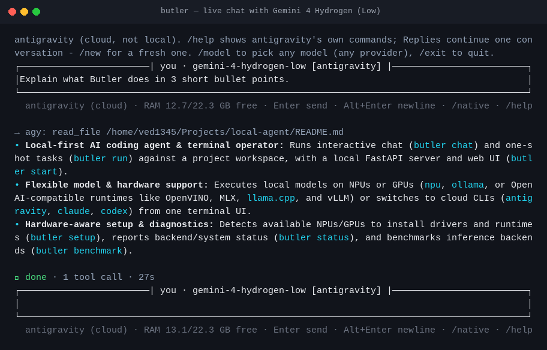
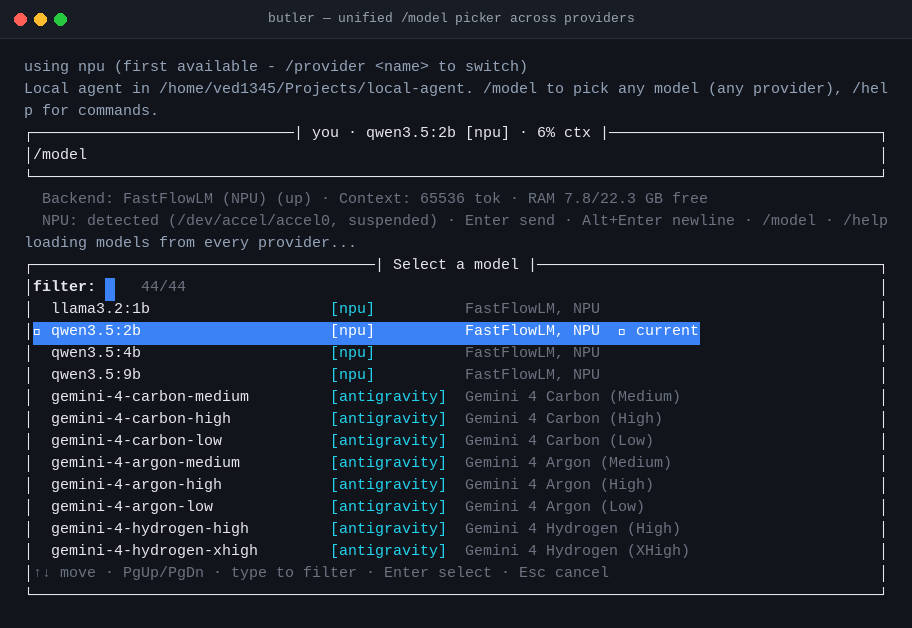
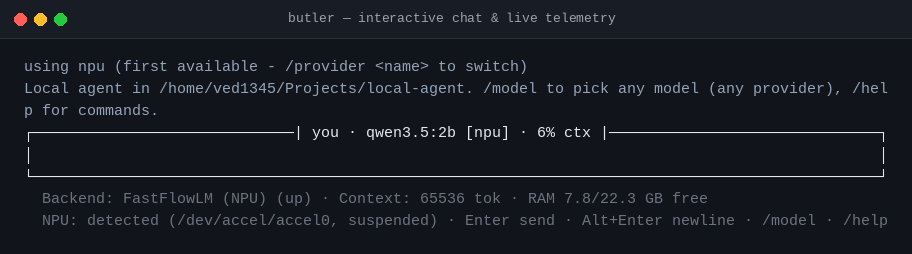
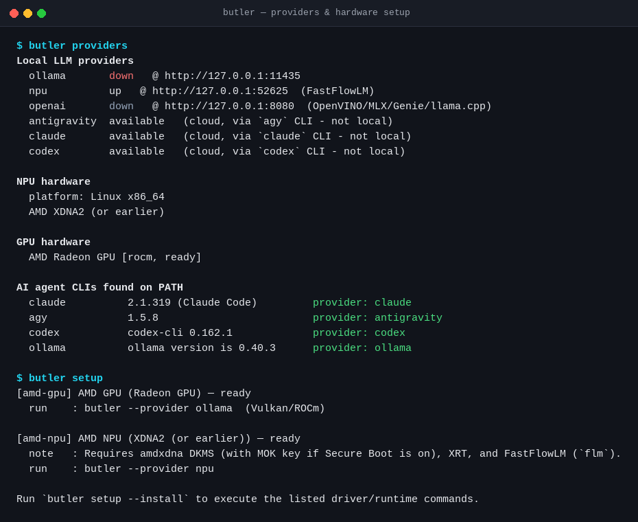

# Butler (`v0.1.0-beta`)

A local-first AI coding agent and terminal operator. Run **local models on your NPU or GPU** (`npu`, `ollama`, or any OpenAI-compatible runtime like OpenVINO, MLX, Qualcomm Genie, `llama.cpp`, or vLLM), or switch seamlessly to cloud CLIs (`antigravity`, `claude`, `codex`) from one unified terminal UI.

---

## Screenshots

### Live Chat (`gemini-4-hydrogen-low` via `antigravity`)


### Unified `/model` Picker (NPU + Cloud Models)


### Interactive Terminal UI (`butler chat`)


### Hardware & Provider Detection (`butler providers` & `butler setup`)


---

## Install (`v0.1.0-beta` — standalone binary, no Python required)

### Linux (Fedora, Ubuntu, Debian, Arch, Alpine — `x86_64` & `arm64`) & macOS
```sh
curl -fsSL https://raw.githubusercontent.com/vedpatil-dev/butler-agent/v0.1.0-beta/install.sh | sh
```
* Automatically detects `x86_64` vs `arm64` and `glibc` vs `musl` (Alpine).
* On macOS, downloads and installs from `Butler-macOS.dmg`.

### Windows (PowerShell)
```powershell
irm https://raw.githubusercontent.com/vedpatil-dev/butler-agent/v0.1.0-beta/install.ps1 | iex
```

### Direct downloads
Prebuilt binaries (`butler-linux-x86_64`, `butler-linux-arm64`, `butler-linux-x86_64-musl`, `butler-linux-arm64-musl`, `butler-windows-x86_64.exe`, `Butler-macOS.dmg`) are available on the [Releases page](https://github.com/vedpatil-dev/butler-agent/releases).

---

## Quick Start

```sh
# 1. Detect your GPU / NPU and install drivers & runtimes
butler setup
butler setup --install

# 2. Pull a default local model (if using Ollama)
ollama pull qwen3.5:9b

# 3. Start chatting in the current project
butler
```

Common CLI subcommands:
```sh
butler chat -C ~/Projects/my-app        # interactive chat (default)
butler run "List files and run tests"   # one-shot task (--json for scripts)
butler providers                        # show detected NPUs, GPUs, and providers
butler setup [--install] [--yes]        # hardware-aware driver/runtime setup
butler start                            # start local FastAPI server + web UI (127.0.0.1:8000)
butler stop [--unload]                  # stop local server
butler status                           # backend, model, context, RAM, and NPU status
butler benchmark --raw ...              # benchmark inference backends
```

---

## Supported Hardware & Providers

| Provider | Target Hardware / Backend | Notes |
|---|---|---|
| `npu` | **AMD XDNA2 NPU** (`flm serve` / FastFlowLM) | Starts in background so the UI opens immediately |
| `ollama` | **NVIDIA CUDA**, **AMD ROCm/Vulkan**, **Intel iGPU/Arc**, **Apple Metal**, **CPU** | Uses `AGENT_LLM_URL` (default `http://127.0.0.1:11434`) |
| `openai` | **Intel NPU** (OpenVINO), **Snapdragon Hexagon NPU** (Genie/QNN), **Apple Silicon** (`mlx_lm.server`), **`llama.cpp`**, **vLLM** | Uses `AGENT_OPENAI_URL` (default `http://127.0.0.1:8080`) |
| `antigravity` | `agy` CLI | Delegates to `agy` (use `/native` for full interactive TUI) |
| `claude` | `claude` CLI | Delegates to `claude` (use `/native` for full interactive TUI) |
| `codex` | `codex` CLI | Delegates to `codex` (use `/native` for full interactive TUI) |

---

## In-Chat Commands

Type `/` for live auto-complete or `@` to mention project files:

- `/model [id]` — Arrow-key live-filtered picker across **all reachable providers**
- `/provider [name]` — Switch between `npu`, `ollama`, `openai`, `antigravity`, `claude`, `codex`
- `/native` — Hand the terminal PTY to `agy`, `claude`, or `codex` interactively (resuming your session), then return to `butler` on exit
- `/approval [ask|auto-edit|readonly]` — Control confirmation behavior for edits and commands
- `/plan [on|off]` — Read-only investigation & planning mode
- `/effort [low|medium|high|xhigh|max]` — Reasoning effort (`claude`)
- `/status`, `/diff`, `/compact`, `/undo`, `/mcp`, `/init`
- `/resume [provider|all]` — Resume an earlier conversation
- `/new` / `/clear` — Reset context and clear screen + scrollback
- `/exit` — Quit

---

## Safety & Sandboxing

- **Workspace confinement**: File tools are confined to `AGENT_WORKSPACE` (and block secret files like `.env`, `.ssh`, private keys, `credentials*`, `secrets*`).
- **Approval gates**: `WRITE` and `DANGEROUS` actions require confirmation (with unified diffs for `edit_file`, `create_file`, and `multi_edit`).
- **Shell sandbox**: On Linux, `execute_command` uses `bwrap` (bubblewrap) when available (read-only system, project RW, no network by default, scrubbed env).
- **Local-only server**: `butler start` binds strictly to `127.0.0.1` with Host/Origin checks and a per-install `X-Agent-Token`.

---

## Development (From Source)

Requires Python **3.12+** and `uv`:

```sh
git clone -b v0.1.0-beta https://github.com/vedpatil-dev/butler-agent.git
cd butler-agent
uv sync
.venv/bin/python -m pytest -m "not llm" -q
```

Build a standalone binary locally:
```sh
uv pip install pyinstaller
uv run python scripts/build_binary.py
```

---

## Configuration (`.env`)

Copy `.env.example` to `.env` to customize defaults:
- `AGENT_LLM_URL` — Ollama URL (default `http://127.0.0.1:11434`)
- `AGENT_MODEL` — Default Ollama model (default `qwen3.5:9b`)
- `AGENT_NPU_URL` / `AGENT_NPU_MODEL` / `AGENT_NPU_CTX` — FastFlowLM NPU settings
- `AGENT_OPENAI_URL` / `AGENT_OPENAI_MODEL` / `AGENT_OPENAI_CTX` — Local OpenAI-compatible server settings
- `AGENT_SANDBOX` — `0` to disable `bwrap`, `require` to fail if `bwrap` is unavailable
